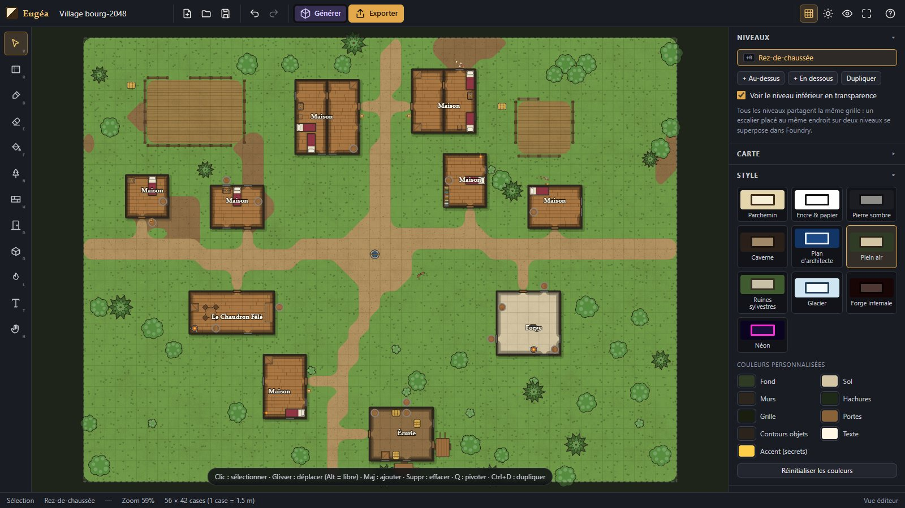
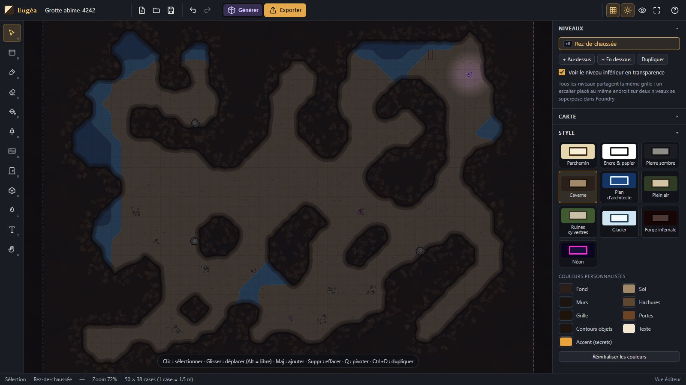
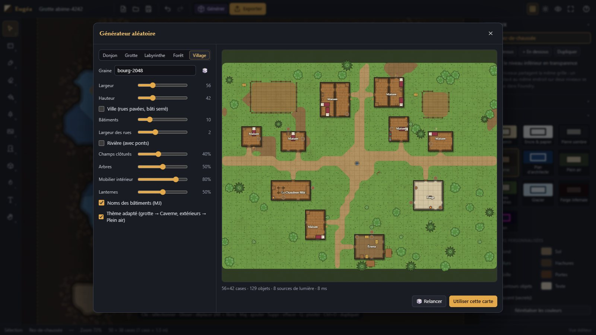

# Eugéa

**Éditeur de cartes pour le jeu de rôle** : cartes de combat (donjons, grottes, labyrinthes, forêts, villages, tavernes sur plusieurs étages), plans de ville et cartes du monde, avec un **export direct vers Foundry VTT** où tout est déjà posé : murs, portes, remparts, lumières, chaque objet en tuile, toits, niveaux, escaliers et passages reliés, jour ou nuit.

Rapide même sur de grandes cartes, entièrement dans le navigateur, sans compte ni serveur.

**[▶ Ouvrir Eugéa dans le navigateur](https://alexisrodenas.github.io/eugea-map-maker/)**



| Donjon | Forêt | Grotte (aperçu de l'éclairage) |
| --- | --- | --- |
|  |  |  |

## Utiliser Eugéa

- **En ligne** : [alexisrodenas.github.io/eugea-map-maker](https://alexisrodenas.github.io/eugea-map-maker/).
- **Hors-ligne** : téléchargez `eugea.html` dans la dernière [Release](https://github.com/AlexisRodenas/eugea-map-maker/releases/latest) et ouvrez-le dans votre navigateur. Un seul fichier, rien à installer.
- **Depuis les sources** (Windows) : double-cliquez sur `Lancer.bat`, ou `npm install` puis `npm run dev`.

Le travail est **sauvegardé automatiquement** dans le navigateur. `Ctrl+S` télécharge un fichier `.eugea.json`, à rouvrir avec le bouton Ouvrir ou par glisser-déposer. Les images personnelles utilisées sur la carte sont incluses dans ce fichier.

## Fonctionnalités

**Dessin**
- Salles (rectangle / ellipse), pinceau, gomme, remplissage : les murs se créent automatiquement autour du sol.
- Cloisons, portes normales / verrouillées / **secrètes**, fenêtres, herses.
- Murs droits, arrondis ou **organiques** (grottes naturelles).
- Sols : dalle, plancher, carrelage, tapis, terre, herbe, roche, eau, eau profonde, lave, gouffre.
- **Terrain extérieur** sous les bâtiments : herbe, sous-bois, champ, chemin, pavés, sable, boue, rocaille, neige, rivières… sans murs ni hachures.
- Plus de 60 objets vectoriels (mobilier, escaliers, autels, arbres, sapins, charrettes, étals, ponts, tentes, lanternes, portes fortifiées…), nets à toute résolution, avec ombres portées.
- **Pinceau de dispersion** : glissez pour semer des objets au hasard (taille et orientation variées) : forêt mixte, sous-bois, rocaille, marais, un objet précis ou vos propres images.
- Lumières avec **aperçu dynamique** : ombres projetées par les murs, portes et colonnes, comme dans Foundry.
- Textes et numérotation automatique des salles.
- **Étages** : autant de niveaux que nécessaire (sous-sols, étages), sur la même grille, avec le niveau inférieur affiché en transparence pour aligner escaliers et murs.

**Remparts** (outil `M`) : murailles de pierre crénelées ou palissades de rondins, tracées sommet par sommet, avec tours aux angles. `Maj` + clic sur un rempart y perce une porte (porte fortifiée ou portail). Dans Foundry, les remparts deviennent des murs et les portes de vraies portes. Le générateur de village peut entourer le bourg d'une enceinte, avec une porte sur chaque route.

**Passages entre étages** (outil `J`) : un clic au départ, un clic à l'arrivée, sur le même étage ou un autre (trappe vers la cave, échelle, tunnel, portail…). Les escaliers, échelles et trappes sont reliés tout seuls à l'étage voisin. Dans Foundry (v12 et plus), un jeton qui entre dans la zone est téléporté à l'autre bout.

**Toits** : chaume, tuiles, ardoise, bardeaux, auvents, frondaisons. Un toit se pose en glissant un rectangle, ou d'un clic sur « Couvrir chaque bâtiment ». N'importe quel objet (arbre, pont, image…) peut aussi devenir un toit. Dans Foundry, les toits passent au-dessus des jetons et s'effacent quand un jeton entre dessous. La touche `K` permet de voir à travers pour travailler l'intérieur.

**Vos images** (onglet *Objets → Mes images*) : connectez un dossier d'images (PNG, WebP, SVG… par exemple un pack d'assets), avec recherche et sous-dossiers, ou glissez des images directement sur la carte. Une image peut aussi **remplacer le dessin d'un objet intégré** (vos arbres à la place des arbres d'Eugéa, vos coffres…), y compris dans les cartes générées, avec plusieurs variantes tirées au hasard. Dans Foundry, elles deviennent des tuiles avec le fichier d'origine, sans perte de qualité. Si le dossier est déjà dans les données de Foundry, indiquez son chemin (*Dans Foundry*) : l'export réutilise les fichiers au lieu de les recopier.

**Arbres** : un tronc et un feuillage. Dans Foundry, le feuillage passe au-dessus des jetons et s'efface quand un jeton passe dessous ; la touche `K` montre les troncs dans l'éditeur.

**Infos MJ** : portes secrètes, pièges, numéros et textes « MJ » n'apparaissent pas dans l'image des joueurs (touche `P` pour prévisualiser).

**Styles** : 10 thèmes (Parchemin, Encre & papier, Pierre sombre, Caverne, Plan d'architecte, Plein air, Ruines sylvestres, Glacier, Forge infernale, Néon), toutes les couleurs personnalisables, effets autour des murs (hachures, ombre) désactivables, ombres des objets et vignette.

**Générateurs aléatoires** (`Ctrl+G`), avec aperçu en direct et graine reproductible :
- **Donjon** : salles dispersées ou compactes, couloirs, boucles, portes, salles rondes / en croix / à colonnes, eau. Une ambiance (crypte, forteresse, temple, repaire) décide du mobilier de chaque salle.
- **Donjon sur plusieurs niveaux** : sous-sols reliés par des escaliers placés au même endroit.
- **Grotte** : automate cellulaire, tunnels, eau et lave, stalagmites, cristaux lumineux.
- **Labyrinthe** : murs pleins ou fins, salles, culs-de-sac réglables, trésors et pièges.
- **Forêt** : sentier sinueux et embranchements, ruisseau avec pont, clairière avec campement, ruines, version hivernale, cimes des arbres en toits.
- **Village / ville** : rues, place centrale avec puits ou fontaine, maisons, taverne, forge, échoppes, chapelle, granges, **bâtiments aménagés de façon réaliste** (taverne avec comptoir, tabourets, cheminée, cuisine, réserve et chambres à l'étage ; maisons avec salle commune, chambres et étage ; forge avec foyer et enclume…), abords (potagers, bûches, abreuvoirs, enseignes, cimetière), **toits**, champs clôturés, rivière et ponts, lanternes, **enceinte** (palissade ou muraille) ; rues pavées et étals en mode ville.
- **Plan de ville** (1 case = 5 m) : grande cité fortifiée en quartiers, ville ou bourg rural ; rues, place du marché, cathédrale, château, remparts et portes, rivière et ponts, campagne alentour, noms des quartiers.
- **Monde** (1 case = 5 km) : continent, archipel ou terres intérieures ; côtes, rivières, montagnes et forêts en pictogrammes, villes reliées par des routes, mers et montagnes nommées, rose des vents.



## Export vers Foundry VTT

| Format | Contenu |
| --- | --- |
| **Foundry VTT** (`.foundry.json`) | Un seul fichier, tout est posé à l'import : images de chaque niveau, murs, portes, fenêtres, remparts, lumières, **chaque objet en tuile** (meubles, arbres en tronc + feuillage, toits), étages, **escaliers et passages reliés**, notes MJ en dessins cachés, **jour ou nuit**. S'importe avec le module **[Eugéa Importer](https://github.com/AlexisRodenas/eugea-importer)**. |
| **Universal VTT** (`.dd2vtt`) | Pour le module *Universal Battlemap Importer* et les autres VTT compatibles. Un fichier par niveau. |
| **Image** (WebP / PNG / JPEG) | Impression, Roll20, Owlbear, Discord… Version joueurs ou MJ, avec ou sans les toits. |
| **Scènes JSON + images** (`.zip`) | Sans module : à décompresser dans `Data/`, puis *Importer des données* sur une scène. Choisissez la version de Foundry (V14 et plus, ou v11 à v13). |

**Étages dans Foundry** : sur Foundry **V14**, une carte à plusieurs étages devient une seule scène avec des **niveaux natifs**, et les escaliers sont reliés par des zones « Changer de niveau ». Sur V11 à V13, ou si vous le choisissez dans les réglages du module, chaque étage devient une scène, regroupées dans un dossier et accessibles depuis la barre de navigation.

**Transitions** : les passages et les escaliers deviennent des zones de téléportation (comportement « Téléporter le jeton », d'une scène à l'autre si besoin) à partir de Foundry v12. Sur v11, qui n'a pas de zones, ils sont signalés au MJ par des dessins cachés.

### Installer le module Eugéa Importer

Le module a son propre dépôt : **[AlexisRodenas/eugea-importer](https://github.com/AlexisRodenas/eugea-importer)**.

1. Dans Foundry : *Modules complémentaires → Installer un module*.
2. Collez ce lien de manifeste, puis *Installer* :
   ```
   https://github.com/AlexisRodenas/eugea-importer/releases/latest/download/module.json
   ```
3. Activez **Eugéa Importer** dans votre monde.
4. Onglet **Scènes** → **Importer une carte Eugéa** → choisissez le fichier `.foundry.json`.

## Raccourcis

| Touche | Action |
| --- | --- |
| `V` `R` `B` `E` `F` `N` `W` `D` `M` `O` `L` `T` `J` `H` | Sélection, Salle, Pinceau, Gomme, Remplissage, Terrain, Mur, Porte, Rempart, Objets, Lumière, Texte, Passage, Main |
| Molette / clic molette / Espace | Zoom / déplacer la vue |
| Clic droit | Effacer (salle, pinceau, terrain, porte, objet, lumière) |
| `Q` ou `Maj`+molette | Pivoter l'objet |
| `Alt` | Placement libre (hors grille) |
| `[` `]` | Taille du pinceau |
| `Alt`+molette | Rayon du pinceau de dispersion |
| `Maj`+clic sur un rempart | Percer une porte (outil Rempart) |
| `Page ↑` / `Page ↓` | Niveau supérieur / inférieur |
| `G` / `P` / `I` / `K` / `0` | Grille / vue joueurs / aperçu de l'éclairage / voir à travers les toits / recadrer |
| `Ctrl+Z` `Ctrl+Y` `Ctrl+S` `Ctrl+G` `Ctrl+E` | Annuler, rétablir, enregistrer, générer, exporter |

## Développement

```
npm install
npm run dev      # serveur de développement
npm run check    # vérification TypeScript
npm run build    # dist/index.html autonome (un seul fichier)
```

Code dans `src/` : `model.ts` (carte, niveaux, passages), `geometry.ts` (contours, lissage, hachures), `render.ts` (rendu Canvas), `lighting.ts` (visibilité), `props.ts` (objets et toits), `ramparts.ts` (remparts), `assets.ts` (images personnelles), `generators/` (donjon, grotte, labyrinthe, forêt, village), `export.ts` (Foundry, Universal VTT, image), `app.ts`, `tools.ts` et `tools-extra.ts` (interface).

Les nouveautés de chaque version sont dans le [journal des modifications](CHANGELOG.md).

Les contributions sont les bienvenues : ouvrez une [issue](https://github.com/AlexisRodenas/eugea-map-maker/issues) pour signaler un bug ou proposer une idée.

---

### English

Eugéa is a browser-based TTRPG map editor: battle maps (dungeons, caves, mazes, forests, villages with realistically furnished multi-floor buildings), city plans and world maps, with your own image folder (assets can also replace the built-in drawings), a scatter brush, city walls and palisades, and roofs and tree canopies that fade when tokens walk under them. Export to Foundry VTT is fully set up: walls, doors, ramparts, lights, separate object tiles, roof tiles, native Scene Levels on V14, and stairs and passages turned into teleport regions (v12+). Try it at [alexisrodenas.github.io/eugea-map-maker](https://alexisrodenas.github.io/eugea-map-maker/), and install the [Eugéa Importer](https://github.com/AlexisRodenas/eugea-importer) module with the manifest link above. The interface is in French.

## Licence

[MIT](LICENSE)
