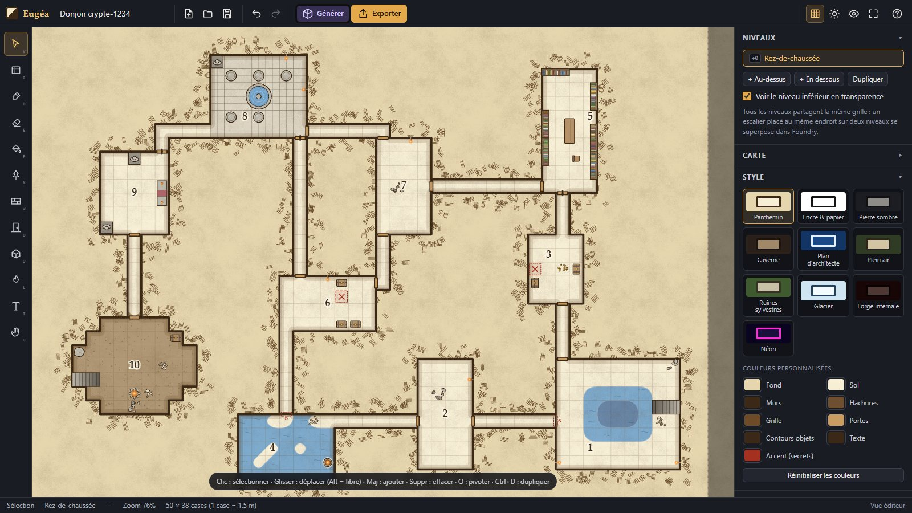
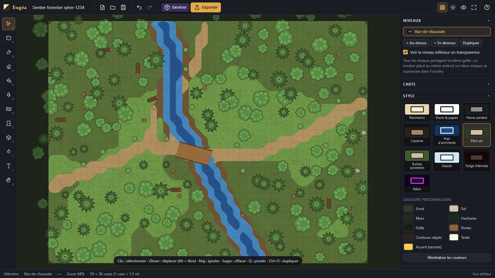

# Eugéa

**Éditeur de cartes pour le jeu de rôle** : donjons, grottes, labyrinthes, forêts, villages et villes, sur plusieurs étages, avec un **export direct vers Foundry VTT** (murs, portes, lumières, objets séparés, niveaux).

Rapide même sur de grandes cartes, entièrement dans le navigateur, sans compte ni serveur.


| Donjon | Forêt | Grotte (aperçu de l'éclairage) |
| --- | --- | --- |
|  |  |  |

## Utiliser Eugéa

- **En ligne** : la page GitHub Pages du dépôt (onglet *Environments → github-pages*).
- **Hors-ligne** : téléchargez `eugea.html` dans la dernière [Release](../../releases) et ouvrez-le dans votre navigateur. Un seul fichier, rien à installer.
- **Depuis les sources** (Windows) : double-cliquez sur `Lancer.bat`, ou `npm install` puis `npm run dev`.

Le travail est **sauvegardé automatiquement** dans le navigateur. `Ctrl+S` télécharge un fichier `.eugea.json` (à rouvrir avec le bouton Ouvrir ou par glisser-déposer).

## Fonctionnalités

**Dessin**
- Salles (rectangle / ellipse), pinceau, gomme, remplissage : les murs se créent automatiquement autour du sol.
- Cloisons, portes normales / verrouillées / **secrètes**, fenêtres, herses.
- Murs droits, arrondis ou **organiques** (grottes naturelles).
- Sols : dalle, plancher, carrelage, tapis, terre, herbe, roche, eau, eau profonde, lave, gouffre.
- **Terrain extérieur** sous les bâtiments : herbe, sous-bois, champ, chemin, pavés, sable, boue, rocaille, neige, rivières… sans murs ni hachures.
- Plus de 50 objets vectoriels (mobilier, escaliers, autels, arbres, sapins, charrettes, étals, ponts, tentes, lanternes…), nets à toute résolution.
- Lumières avec **aperçu dynamique** : ombres projetées par les murs, portes et colonnes, comme dans Foundry.
- Textes et numérotation automatique des salles.
- **Étages** : autant de niveaux que nécessaire (sous-sols, étages), sur la même grille, avec le niveau inférieur affiché en transparence pour aligner escaliers et murs.

**Infos MJ** : portes secrètes, pièges, numéros et textes « MJ » n'apparaissent pas dans l'image des joueurs (touche `P` pour prévisualiser).

**Styles** : 10 thèmes (Parchemin, Encre & papier, Pierre sombre, Caverne, Plan d'architecte, Plein air, Ruines sylvestres, Glacier, Forge infernale, Néon) et toutes les couleurs personnalisables.

**Générateurs aléatoires** (`Ctrl+G`), avec aperçu en direct et graine reproductible :
- **Donjon** : salles dispersées ou compactes, couloirs, boucles, portes, salles rondes / en croix / à colonnes, eau. Une ambiance (crypte, forteresse, temple, repaire) décide du mobilier de chaque salle.
- **Grotte** : automate cellulaire, tunnels, eau et lave, stalagmites, cristaux lumineux.
- **Labyrinthe** : murs pleins ou fins, salles, culs-de-sac réglables, trésors et pièges.
- **Forêt** : sentier sinueux et embranchements, ruisseau avec pont, clairière avec campement, ruines, version hivernale.
- **Village / ville** : rues, place centrale avec puits ou fontaine, maisons, taverne, forge, échoppes, chapelle, granges, intérieurs meublés, portes et fenêtres, champs clôturés, rivière et ponts, lanternes ; rues pavées et étals en mode ville.


## Export vers Foundry VTT

| Format | Contenu |
| --- | --- |
| **Foundry VTT** (`.foundry.json`) | Un seul fichier : images de chaque niveau, murs, portes, fenêtres, lumières, **objets séparés en tuiles** (coffres, tonneaux, caisses… déplaçables ou masquables), notes MJ en dessins cachés. S'importe avec le module **Eugéa Importer**. |
| **Universal VTT** (`.dd2vtt`) | Pour le module *Universal Battlemap Importer* et les autres VTT compatibles. Un fichier par niveau. |
| **Image** (WebP / PNG / JPEG) | Impression, Roll20, Owlbear, Discord… Version joueurs ou MJ. |
| **Scènes JSON + images** (`.zip`) | Sans module : à décompresser dans `Data/`, puis *Importer des données* sur une scène. |

**Étages dans Foundry** : sur Foundry **V14**, une carte à plusieurs étages devient une seule scène avec des **niveaux natifs**, et les escaliers sont reliés par des zones « Changer de niveau ». Sur V11–V13, ou si vous le choisissez dans les réglages du module, chaque étage devient une scène, regroupées dans un dossier et accessibles depuis la barre de navigation.

### Installer le module Eugéa Importer

1. Dans Foundry : *Modules complémentaires → Installer un module*.
2. Collez le lien du `module.json` de la dernière [Release](../../releases) (clic droit sur `module.json` → copier le lien), puis *Installer*.
3. Activez **Eugéa Importer** dans votre monde.
4. Onglet **Scènes** → **Importer une carte Eugéa** → choisissez le fichier `.foundry.json`.

Le module envoie les images dans `Data/eugea/`, crée la scène (grille, murs, portes, lumières, tuiles, dessins MJ), génère la miniature et ouvre la carte. Compatible Foundry v11 à v14.

## Raccourcis

| Touche | Action |
| --- | --- |
| `V` `R` `B` `E` `F` `N` `W` `D` `O` `L` `T` `H` | Sélection, Salle, Pinceau, Gomme, Remplissage, Terrain, Mur, Porte, Objets, Lumière, Texte, Main |
| Molette / clic molette / Espace | Zoom / déplacer la vue |
| Clic droit | Effacer (salle, pinceau, terrain, porte, objet, lumière) |
| `Q` ou `Maj`+molette | Pivoter l'objet |
| `Alt` | Placement libre (hors grille) |
| `[` `]` | Taille du pinceau |
| `Page ↑` / `Page ↓` | Niveau supérieur / inférieur |
| `G` / `P` / `I` / `0` | Grille / vue joueurs / aperçu de l'éclairage / recadrer |
| `Ctrl+Z` `Ctrl+Y` `Ctrl+S` `Ctrl+G` `Ctrl+E` | Annuler, rétablir, enregistrer, générer, exporter |

## Développement

```
npm install
npm run dev      # serveur de développement
npm run check    # vérification TypeScript
npm run build    # dist/index.html autonome (un seul fichier)
```

Code dans `src/` : `model.ts` (carte, niveaux), `geometry.ts` (contours, lissage, hachures), `render.ts` (rendu Canvas), `lighting.ts` (visibilité), `props.ts` (objets), `generators/` (donjon, grotte, labyrinthe, forêt, village), `export.ts` (Foundry, Universal VTT, image), `app.ts` et `tools.ts` (interface). Le module Foundry est dans `foundry-module/eugea-importer`.

**Publier une version** : `git tag v1.0.0 && git push --tags`. Le workflow *Release* construit `eugea.html`, le zip du module et son `module.json` (liens de manifeste remplis automatiquement). Le workflow *Pages* publie l'éditeur à chaque push sur `main` (à activer une fois dans *Settings → Pages → Source : GitHub Actions*).

---

### English

Eugéa is a browser-based TTRPG battle map editor: dungeons, caves, mazes, forests, villages and towns, multi-floor, with one-click export to Foundry VTT (walls, doors, lights, separate object tiles, native Scene Levels on V14). Install the **Eugéa Importer** module with the `module.json` link from the latest release, then use *Scenes → Import an Eugéa map*. The interface is in French.

## Licence

[MIT](LICENSE)
